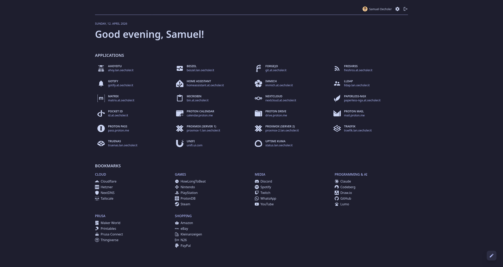

# Dash




A self-hosted, multi-user home-lab dashboard — inspired by [Flame](https://github.com/pawelmalak/flame), rebuilt for modern homelabs.

Sign in with your existing identity provider, get a personal dashboard with bookmarks and themes, and share application links with friends and family.

> [!WARNING]
> This project emerged from my personal homelab needs for a flexible multi-user dashboard. While the core features are production-ready and actively used in my daily workflow, the codebase is under active development as I continue to add features and refinements. Early adopters should note this experimental status and evaluate carefully before deploying in critical production environments.

## Highlights

- Multi-user with OAuth2/OIDC
- Per-user dashboards, bookmarks, and themes
- Shared application links with group-based visibility
- PostgreSQL backed, Docker image for amd64 and arm64

## Quick Start

```bash
cp docker/compose/dash.env.example docker/compose/dash.env
cp docker/compose/postgres.env.example docker/compose/postgres.env
# fill in both files

docker compose -f docker/compose/compose.yml up -d
```

## Identity Provider

Dash requires an OAuth2/OIDC identity provider. Any standard-compliant IdP works — the only hard requirement is that it emits a `groups` claim so Dash can distinguish regular users from admins.

**Recommended: [Pocket ID](https://pocket-id.org)**

Pocket ID is a lightweight, self-hosted OIDC provider built for homelabs. It supports passkey login, has a clean admin UI, and is trivial to run alongside Dash. It is the IdP this project is tested against.

Once you have Pocket ID running and have created an OIDC client, set the following in `dash.env`:

```env
OIDC_ISSUER=https://id.yourdomain.com
OIDC_CLIENT_ID=<client-id-from-pocket-id>
OIDC_CLIENT_SECRET=<client-secret-from-pocket-id>
OIDC_REDIRECT_URL=https://dash.yourdomain.com/api/v1/sessions/login/callback
OIDC_ADMIN_GROUP=admin
```

Any other OIDC-compliant provider works equally well — self-hosted options like Authentik, Keycloak, or Authelia, as well as social platforms like GitHub or Google (via an OAuth2 proxy that adds a `groups` claim).

## Images

Docker images are published to the registries of this repository:

- `:main` — current stable development state, updated on every push to `main`
- `:latest` — latest release
- `:vX.Y.Z` — immutable tag for each release, following semantic versioning

## Contributing

Contributions and pull requests are welcome!

## Codebase map

Dash is organized as one service with domain-oriented modules, not as a set of
independently deployed services. Most business modules follow the same layout:

- `domain/` contains domain types and invariants.
- `application/` contains use cases and the ports they need.
- `infrastructure/` implements those ports, including SeaORM persistence.
- `composition/` wires service-wide infrastructure and collects migrations.

Cross-domain coordination belongs in application use cases. Keep persistence
models and adapter details out of domain code; add schema changes as new,
versioned migrations next to the owning module. Transfer formats are versioned
under `src/transfer/presentation/formats/` and map external documents into
application models.

Run the standard local checks with:

```bash
cargo fmt --check
cargo clippy --all-targets -- -D warnings
cargo test
cargo check --no-default-features
```

The HTTP server contract is generated from `spec/openapi.yaml` with OpenAPI
Generator 7.26.0. Regenerate it with `scripts/generate-openapi-server.sh` after
changing the schema. The generated Axum router is exposed at
`dash::presentation::http::router`; the binary builds the PostgreSQL/OIDC
composition and serves it with Axum. Endpoint-to-application adapters belong in
handwritten, per-operation handler modules, not in generated files.

The server reads `DATABASE_URL`, `DASH_OIDC_ISSUER_URL`, `DASH_OIDC_CLIENT_ID`,
and `DASH_OIDC_REDIRECT_URL`. `DASH_OIDC_CLIENT_SECRET` is optional;
`DASH_OIDC_ADMIN_GROUP` configures the administrator group, and
`DASH_OIDC_GROUPS_CLAIM` / `DASH_OIDC_SCOPES_CLAIM` select the provider claim
names (defaults: `groups` / `scope`). `DASH_OIDC_SCOPES` controls requested
OIDC scopes, and `DASH_OIDC_POST_LOGOUT_REDIRECT_URL` optionally overrides the
post-logout return URL. Ensure the provider supplies the Dash API scopes
declared in `spec/openapi.yaml` and advertises an RP-initiated logout endpoint.
Set `DASH_SESSION_SIGNING_KEY` to a
random secret of at least 32 bytes; it signs the browser session's authorization
claims. The optional listener address is `DASH_HTTP_BIND` (default
`127.0.0.1:3000`).

## License

MIT — see [LICENSE](./LICENSE).
